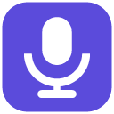

# Voice Typer

A small Windows program that types what you say, into whatever you're using: a browser, Discord, Word, Notepad.

I wrote it because Windows' own voice typing (Win+H) wouldn't work for me with my phone as the microphone. Voice Typer uses the speech recognizer that is already built into Windows, so it works offline and nothing leaves your PC.



## Download

Get `VoiceTyper.exe` from the [latest release](../../releases/latest). It's a single file with no installer. To remove it, delete the file (and `%APPDATA%\VoiceTyper` if you want the settings gone too).

Edge and Windows SmartScreen will probably warn that the file "isn't commonly downloaded", and a few antivirus engines may flag it. Read the section on that below before you decide.

## Using it

1. Open `VoiceTyper.exe`.
2. Click into a text box in another program.
3. Press **Ctrl+Alt+D**, or click the tray icon, or press Start in the window. You hear a rising tone and the icon turns red.
4. Talk. The words are typed where your cursor is.
5. Press Ctrl+Alt+D again to stop (falling tone).

Closing the window leaves it running in the tray. Use the tray menu to exit.

Say "scratch that" or "delete that" to remove the last phrase (English only). With spoken punctuation on, "comma", "period", "full stop", "question mark", "exclamation mark" and "colon" turn into the symbols. There's no "new line" command on purpose, since Enter would send your chat message.

The window also has a level meter, a language list, a strictness slider (higher means it ignores phrases Windows isn't sure about) and a few switches.

## Languages

Voice Typer lists whatever speech languages Windows has installed. On most PCs that's just English (United States). To add more, such as English (United Kingdom), French, German, Spanish, Italian, Japanese or Chinese, go to Settings > Time & language > Language, add the language and tick its speech recognition feature. Which languages have an offline speech pack depends on your version of Windows, and I haven't found one for Arabic.

I've only tried English (United States), because it's the only one installed on my PC. The other languages should work but I can't promise it.

## Antivirus warnings and VirusTotal

Some versions of this program get flagged on VirusTotal. It's a false positive, but you shouldn't just take my word for it, so here is exactly what VirusTotal shows.

| Version | SHA-256 | Result | Engines that flagged it |
|---|---|---|---|
| 1.0.0 | `543e67de3c8b90a15ae0a46931dab63b6f8b590614bc871e54987d46becce28e` | **5 of 68** | MaxSecure: `Trojan.Malware.300983.susgen`. McAfee Scanner: `Ti!543E67DE3C8B`. SecureAge: `Malicious`. SentinelOne (Static ML): `Static AI - Suspicious PE`. Trapmine: `Malicious.moderate.ml.score` |
| 1.0.1 | `2ff76084712a0ce2579e0ef8920684281400c428620d7db26d227c60370c9321` | **1 of 66** | SecureAge: `Malicious` |
| 1.0.2 and 2.0.0 | see the release notes | not scanned when this was written | |

The other 63 to 65 engines said "Undetected", including Acronis, AhnLab, Alibaba, Avira and Arcabit. VirusTotal's popular threat label for 1.0.0 was just "trojan". Windows Defender scanned every build on my PC and found nothing.

**Why it gets flagged.** Look at the names: "Static AI", "Suspicious PE", "ml.score", "susgen". Those are machine-learning or generic guesses, not the name of a known virus. The program does three things that malware also does:

- It registers a global hotkey.
- It listens to the microphone.
- It types keystrokes into other programs, using the Windows `SendInput` call. Keyloggers, macro tools and remote-control software use the same call.

On top of that it's a small .NET program that nobody has downloaded before and it isn't code-signed. A code-signing certificate costs money every year, so I haven't bought one. That combination is what these detectors dislike.

**What I did about it.** Version 1.0.1 added a proper name, version and Windows manifest, which took it from 5 detections to 1. I sent SecureAge a false-positive report for 1.0.1 on 8 November 2026 and haven't heard back yet. I'll update this table when I do.

**How to check it yourself.**

- The whole program is in `src/`, about 600 lines. It has no network code at all.
- Build it yourself (below) and you never have to trust my download.
- Compare your download with the hash in the release notes: `Get-FileHash .\VoiceTyper.exe -Algorithm SHA256`
- Upload it to [virustotal.com](https://www.virustotal.com) and look at the engines that flag it.

## Build from source

You only need the C# compiler that comes with Windows. Run `build.bat`, or in PowerShell:

```powershell
$speech = (Get-ChildItem 'C:\Windows\Microsoft.NET\assembly\GAC_MSIL\System.Speech' -Recurse -Filter System.Speech.dll | Select-Object -First 1).FullName
& 'C:\Windows\Microsoft.NET\Framework64\v4.0.30319\csc.exe' /nologo /target:winexe /optimize+ /out:VoiceTyper.exe /win32icon:icons\app.ico /win32manifest:app.manifest /resource:icons\tray-off.ico,VoiceTyper.tray-off.ico /resource:icons\tray-on.ico,VoiceTyper.tray-on.ico "/r:$speech" /r:System.Windows.Forms.dll /r:System.Drawing.dll src\*.cs
```

`tools/make_icons.py` redraws the icons. `VoiceTyper.exe --selftest` checks the speech setup without opening a window or touching the microphone, and writes the result to `%TEMP%\voicetyper-selftest.txt`.

## Limits

- Windows' offline recognizer is less accurate than cloud services. Speak in full sentences, at a steady pace, close to the microphone.
- It uses the Windows default microphone. If you change the default, restart the program.
- It can't type into programs running as administrator, unless you run Voice Typer as administrator too. Some games and password fields also block typed input.
- Windows 10 and 11, 64-bit.

## License

GNU General Public License v3.0. See [LICENSE](LICENSE). You can use, share and change it, but if you share a changed version it has to stay open source under the same license.
